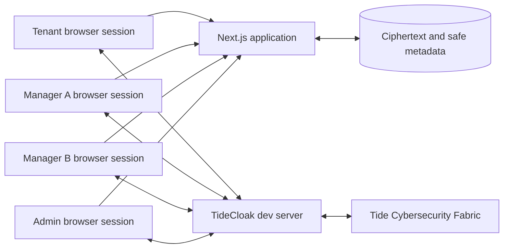

# Architecture

## 1. Architecture Goal

Keep the product small while making one boundary unmistakable: the application can move and display encrypted rental packages, but only an authorised TideCloak user session can turn a package back into plaintext.

## 2. System Context



Each actor uses a separate authenticated browser session. The Next.js application presents the workflow and may serve ciphertext/metadata. TideCloak and the Fabric provide identity, governed permission state, and the E2EE operation.

## 3. Components

The prototype is one full-stack Next.js project. Browser components and Next.js
route handlers share explicit domain contracts, but the browser remains the only
place where plaintext encryption and decryption may occur. Implementation is
sliced by user-visible feature so frontend and backend can progress in parallel
after each shared contract is fixed.

### Next.js user interface

- Shows the current signed-in identity and business role.
- Lets Tenant create the two synthetic packages.
- Presents ciphertext metadata and explicit decrypt controls.
- Shows granted, denied, loading, and integration-error states.
- Never treats a hidden button as the security boundary.

### TideCloak SDK layer

- Initializes the signed-in TideCloak session.
- Exposes login, logout, token/role information, and E2EE helpers.
- Serializes package content before encryption.
- Sends matching tags on encryption and decryption.
- Converts SDK failures into a safe `AccessDecision` without logging plaintext or tokens.

### Ciphertext store

For the prototype, this may be an in-memory store or a minimal local fixture generated at runtime. It contains:

- opaque encrypted payload;
- package ID and type;
- owner and intended recipient IDs;
- required tag;
- creation time and status.

It must not contain employment, salary, payslip, rental history, or reference plaintext.

### Next.js route handlers

- Live in the same project as the frontend.
- Verify the TideCloak access token before returning protected metadata or ciphertext.
- Accept and return ciphertext plus safe metadata only.
- Enforce owner/recipient/auditor metadata scope from verified claims.
- Never call a decrypt helper or receive plaintext package fields.

### TideCloak dev server

- Authenticates the four users.
- Issues claims and the Tide E2EE context required by the SDK.
- Holds realm/client role mappings.
- Routes governed changes through QEA.
- Does not give the application a universal decrypt key.

## 4. Identities and Roles

Business roles may be client roles, while `_tide_...` E2EE permissions are realm roles as required by Tide documentation.

| Identity | Business role | Income tag | Reference tag | Metadata |
| --- | --- | --- | --- | --- |
| `tenant` | `renter` | encrypt + decrypt | encrypt + decrypt | own packages |
| `manager-a` | `property-manager` | decrypt | none | assigned package |
| `manager-b` | `property-manager` | none | decrypt | assigned package |
| `admin` | `auditor` | none | none | all safe metadata |

Business roles improve navigation and presentation. E2EE roles decide whether plaintext can be recovered.

## 5. Tags and E2EE Realm Roles

| Package | Tag passed to SDK | Required Tenant roles | Recipient decrypt role |
| --- | --- | --- | --- |
| Income Pack | `income_manager_a` | `_tide_income_manager_a.selfencrypt`, `_tide_income_manager_a.selfdecrypt` | `_tide_income_manager_a.selfdecrypt` for Manager A |
| Reference Pack | `reference_manager_b` | `_tide_reference_manager_b.selfencrypt`, `_tide_reference_manager_b.selfdecrypt` | `_tide_reference_manager_b.selfdecrypt` for Manager B |

Admin receives no package-specific encrypt or decrypt role. Do not add these roles to `default-roles-<realm>`, because that would give them to every user.

## 6. Minimal Data Model

```ts
type RentalPackageType = 'income' | 'reference';

type RentalPackage = {
  id: string;
  type: RentalPackageType;
  ownerId: string;
  recipientId: string;
  tag: 'income_manager_a' | 'reference_manager_b';
  encryptedPayload: string;
  createdAt: string;
  status: 'active' | 'revoked';
};
```

Synthetic plaintext exists only long enough to serialize and encrypt it in the browser. Any preview after creation should come from an authorised decrypt operation, not from a second plaintext copy.

## 7. Core Data Flows

### Create a package

1. Tenant signs in through TideCloak.
2. Tenant selects or confirms the synthetic package data.
3. The app serializes the object to a string.
4. The browser calls TideCloak `doEncrypt` with the package tag.
5. The app stores the returned ciphertext plus safe metadata.
6. The UI discards the working plaintext value.

### Open a package

1. A signed-in user requests the package.
2. If an API is used, the API verifies the TideCloak token before returning ciphertext/metadata.
3. The browser calls `doDecrypt` with the ciphertext and exact original tag.
4. TideCloak/Fabric evaluates the user's permission context.
5. The UI renders plaintext only on success; otherwise it renders a clear denial.

### Revoke access

1. An administrator proposes removal of the recipient's decrypt role.
2. QEA captures and commits the governed role change after its threshold is met.
3. The recipient signs out/in or refreshes the session so stale token claims are not reused.
4. A new decrypt attempt is denied.
5. Previously viewed or copied plaintext remains outside the system's control.

## 8. Trust Boundaries

| Boundary | Trusted for | Not trusted for |
| --- | --- | --- |
| Browser session | Holding temporary plaintext for the active authorised user | Long-term plaintext storage |
| Next.js application/API | Routing, UI, token verification, ciphertext metadata | Universal decryption |
| Ciphertext store | Availability of encrypted packages and metadata | Confidentiality if plaintext is accidentally stored |
| TideCloak + Fabric | Identity, governed permissions, E2EE operation | Recalling data already shown to a recipient |
| Administrator | Operations and governance proposals | Reading renter package plaintext |

## 9. Security Properties Demonstrated

- Distinct real identities receive distinct capabilities.
- Ciphertext can be stored without giving the storage layer a decrypt key.
- An Admin account without the E2EE role cannot decrypt packages.
- A recipient cannot decrypt a package tagged for the other recipient.
- Permission removal affects future attempts after governance and session renewal.

## 10. Explicit Non-Guarantees

- The prototype is not a production document vault.
- It does not stop an authorised recipient from taking a screenshot or copying visible plaintext.
- A single-admin QEA development realm does not demonstrate multi-party approval.
- Local in-memory storage does not demonstrate durability or multi-device synchronisation.
- UI-level metadata restrictions are not a substitute for API token verification if an API is introduced.

## 11. Architecture Risks

| Risk | Impact | Mitigation |
| --- | --- | --- |
| E2EE roles accidentally assigned as defaults | Every user may decrypt | Inspect each user's effective roles before demo. |
| Stale token after role change | Revocation appears broken | Renew the affected session before retesting. |
| Objects passed directly to E2EE helper | Encryption call fails | Serialize to string or use `Uint8Array`. |
| Plaintext retained for convenient rendering | Demo violates trust claim | Render post-creation previews only from decrypt results. |
| SDK scaffold differs from docs | Broken provider/redirect flow | Treat generated code and current official docs as evidence; update this spec before adapting. |
