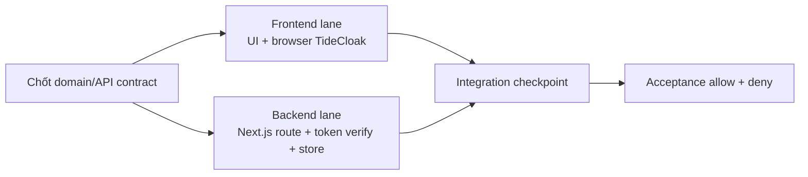
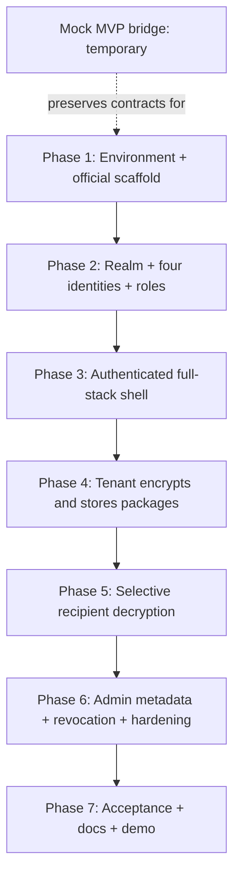

# Kế hoạch triển khai Rental Application Passport

## Trạng thái và phạm vi

Bộ tài liệu này đã được người dùng duyệt cho **temporary mock-MVP
implementation** trong khi TideCloak được bên thứ ba sửa. Mock MVP chỉ là một
integration harness, không thay thế real TideCloak acceptance; mọi màn hình và
kết quả mock phải được gắn nhãn rõ ràng.

Mục tiêu là hoàn thiện prototype trong tối đa bảy giờ, dùng một Next.js project
cho cả frontend và backend. Mỗi capability được giao theo vertical feature
slice: chốt contract chung, làm UI và route/store song song, sau đó tích hợp và
qua checkpoint trước khi đi tiếp.

## Nguồn chân lý

Khi có xung đột, dùng precedence trong [`../CONTENT.md`](../CONTENT.md). Trước
mỗi phase, đọc phần liên quan trong:

1. [`../requirement.md`](../requirement.md)
2. [`../specification.md`](../specification.md)
3. [`../architecture.md`](../architecture.md)
4. [`../tidecloak-integration.md`](../tidecloak-integration.md)
5. [`../demo-guide.md`](../demo-guide.md)
6. [`../decisions/ADR-001-core-architecture.md`](../decisions/ADR-001-core-architecture.md)
7. [`../decisions/ADR-002-temporary-mock-mvp-bridge.md`](../decisions/ADR-002-temporary-mock-mvp-bridge.md)

Nếu generated project hoặc tài liệu Tide hiện hành khác spec, dừng phase, ghi
nhận khác biệt và cập nhật spec trước khi viết code phụ thuộc vào khác biệt đó.

> **Bun command policy:** All commands in this plan use Bun. Commit `bun.lock`;
> do not create or commit `package-lock.json`.

## Mô hình giao việc full-stack theo feature

- FE và BE ở cùng repository và cùng Next.js application.
- FE và BE chỉ làm song song sau khi types, payload shape, status và error shape
  của feature đã được chốt.
- Browser là nơi duy nhất được giữ plaintext tạm thời và gọi E2EE encrypt/decrypt.
- Backend chỉ nhận ciphertext và safe metadata; không có decrypt helper, key hay
  admin bypass.
- Mỗi nhánh công việc phải tích hợp lại trong cùng phase. Không để hai nhánh đi
  sang phase phụ thuộc tiếp theo với contract khác nhau.

## Dependency graph

Các phần có thể song song được ghi riêng trong từng phase. Chuỗi phase vẫn tuần
tự vì identity/policy, shared contract và ciphertext thật là dependency của các
feature sau.

## Lịch thực hiện

| Phase | Kết quả có thể kiểm chứng | Ngân sách | Phụ thuộc |
| --- | --- | ---: | --- |
| [00](00-mock-mvp-bridge.md) | Mock UI/API MVP có nhãn, sẵn sàng thay adapter | Chỉ khi TideCloak bị chặn | User approval |
| [01](01-environment-and-scaffold.md) | TideCloak dev container và official Next.js scaffold chạy được | 45 phút | Không |
| [02](02-realm-identities-and-policies.md) | Bốn tài khoản và E2EE role matrix đúng | 60 phút | Phase 1 |
| [03](03-authenticated-full-stack-shell.md) | Auth shell và token-verified package API tối thiểu | 50 phút | Phase 2 |
| [04](04-tenant-encryption-slice.md) | Tenant tạo hai ciphertext package, backend không nhận plaintext | 65 phút | Phase 3 |
| [05](05-selective-decryption-slice.md) | Tenant/Manager A/Manager B đạt allow/deny matrix | 70 phút | Phase 4 |
| [06](06-admin-revocation-and-hardening.md) | Admin metadata-only, revocation và failure states được chứng minh | 50 phút | Phase 5 |
| [07](07-acceptance-documentation-and-demo.md) | Lint/build, full matrix, README/docs và demo artifact hoàn tất | 50 phút | Phase 6 |
| Dự phòng | Xử lý enrolment, QEA commit, session renewal hoặc Fabric latency | 30 phút | — |
| **Tổng** | | **420 phút** | |

Nếu trễ, cắt polish và automated unit test chưa được cấu hình trước; không cắt
real TideCloak, negative decrypt cases, token verification, lint/build hoặc demo
dưới hai phút.

Trong thời gian TideCloak bị chặn, Phase 00 là ngoại lệ có thời hạn. Nó không
được dùng để đánh dấu các checkpoint Phase 1–7 là đã hoàn thành.

## Definition of Done toàn dự án

- [ ] Official initializer đã tạo `package.json` và lockfile; phiên bản thật được
  ghi vào spec.
- [ ] `tenant`, `manager-a`, `manager-b`, `admin` là bốn TideCloak account riêng.
- [ ] Tenant encrypt/decrypt được cả hai tag bằng E2EE thật.
- [ ] Manager A chỉ decrypt được Income Pack; Manager B chỉ decrypt được Reference Pack.
- [ ] Admin xem safe metadata và không decrypt được package nào.
- [ ] Denial đến từ `doDecrypt`, không chỉ từ UI role check.
- [ ] API route xác minh TideCloak token trước khi trả ciphertext/metadata.
- [ ] Tracked files, server state, browser storage và log không có plaintext nhạy
  cảm, password, token hoặc local TideCloak data.
- [ ] Sau role removal được commit và session renewal, decrypt tương lai bị từ chối.
- [ ] `bun --bun run lint` và `bun --bun run build` pass theo scripts thực tế.
- [ ] README setup và `docs/demo-guide.md` khớp implementation.
- [ ] `demo.mp4` dưới hai phút, dưới 100 MB và không lộ credential.

## Quy tắc kiểm thử

- Không báo `bun test` pass khi `package.json` chưa có test script.
- Automated test chỉ dùng cho pure domain logic nếu toolchain generated đã hỗ
  trợ hoặc đã được người dùng duyệt thêm dependency.
- Mock E2EE không được tính là integration proof.
- Mock MVP phải có banner cố định và không được gọi payload mô phỏng là
  ciphertext hoặc kết quả mô phỏng là TideCloak policy enforcement.
- Manual acceptance matrix bằng TideCloak thật là bắt buộc ở Phase 5–7.
- Sau mọi thay đổi role phải renew session trước khi kết luận quyền mới.

## Điểm dừng bắt buộc

Dừng và hỏi trước khi thêm database, upload, cloud deployment, runtime
dependency, service account quản trị, extra QEA admins, hoặc thay đổi core users,
tags hay access matrix. Dừng và cập nhật spec nếu generated provider, redirect,
middleware, token verifier hoặc E2EE signature khác tài liệu hiện tại.

## Nguồn chính thức đã đối chiếu ngày 2026-10-22

- <https://docs.tide.org/get-started/Tidecloak%20Quickstart>
- <https://docs.tide.org/Languages/NextJS/tidecloak-nextjs-intro>
- <https://docs.tide.org/Languages/NextJS/tidecloak-nextjs-discussion>
- <https://docs.tide.org/Admin/e2ee>
- <https://docs.tide.org/Admin/SetupIGA>

