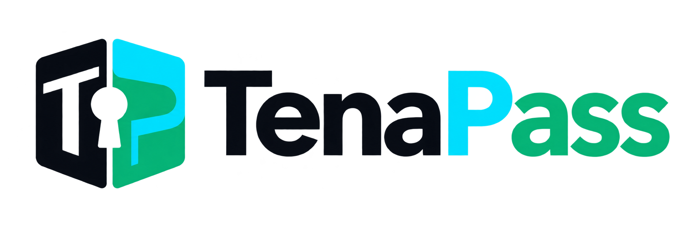

# TenaPass — Kịch bản video giới thiệu và định hướng thương hiệu

> **Loại video:** Video giới thiệu dự án, vấn đề và giá trị sản phẩm  
> **Thời lượng mục tiêu:** 2 phút 40 giây, nằm trong yêu cầu 2–3 phút  
> **Ngôn ngữ thuyết minh:** Tiếng Việt  
> **Giao diện minh họa:** Tiếng Anh theo prototype hiện tại  
> **Đối tượng:** Ban giám khảo UNLOCKED Challenge, cố vấn sản phẩm và người xem không chuyên về bảo mật



## 1. Lưu ý bắt buộc trước khi quay

Kịch bản chính dưới đây được viết cho **bản demo cuối dùng TideCloak thật**. Chỉ đọc các câu khẳng định về xác thực, mã hóa đầu cuối và từ chối bằng chính sách khi toàn bộ ma trận truy cập đã được kiểm chứng bằng bốn tài khoản TideCloak riêng biệt.

Nếu ứng dụng vẫn đang chạy temporary mock bridge:

- chỉ dùng kịch bản để diễn tập góc quay và nhịp dựng;
- không gọi payload mô phỏng là ciphertext;
- không gọi kết quả allow/deny mô phỏng là bằng chứng TideCloak/E2EE;
- không dùng bản diễn tập làm video acceptance của Challenge.

Video này dài 2:40 theo yêu cầu hiện tại. Tài liệu dự án đang yêu cầu `demo.mp4` nộp Challenge phải **dưới 2 phút**; mục 10 cung cấp phương án cắt xuống 1:58 mà vẫn giữ bằng chứng cốt lõi.

## 2. Thương hiệu đề xuất

### Tên chính: TenaPass

**Cách đọc:** /ˈte-nə-pæs/ — “Te-na-pass”  
**Cấu tạo tên:** `Tenant` + `Passport`  
**Tên mô tả đi kèm:** `Rental Application Passport`

TenaPass ngắn hơn tên dự án hiện tại, dễ đặt trên thanh điều hướng và khung kết video, nhưng vẫn giữ đúng ý tưởng “hộ chiếu hồ sơ thuê nhà”. Từ “Pass” còn gợi quyền truy cập có điều kiện: mỗi người chỉ mở được phần đã được cấp phép.

> TenaPass hiện là tên sáng tạo cho prototype, chưa phải kết quả tra cứu nhãn hiệu, tên doanh nghiệp hoặc tên miền. Cần thực hiện kiểm tra pháp lý riêng trước khi thương mại hóa.

### Định vị một câu

> **TenaPass giúp người thuê chia sẻ đúng bằng chứng với đúng người, mà không trao toàn bộ hồ sơ riêng tư cho mọi bên trung gian.**

### Tagline

**Tiếng Anh:** `Share proof. Keep the rest private.`  
**Tiếng Việt:** `Chia sẻ bằng chứng. Giữ riêng phần còn lại.`

### Thông điệp thương hiệu

- **Vấn đề:** Mỗi đơn thuê nhà thường tạo thêm một bản sao có thể đọc được của hồ sơ nhạy cảm.
- **Lời hứa:** Người thuê chỉ chia sẻ đúng nhóm dữ liệu cần thiết cho từng bên nhận.
- **Bằng chứng:** Manager A, Manager B và Admin nhận ba kết quả truy cập khác nhau từ danh tính và quyền TideCloak thật.
- **Điểm khác biệt:** Có quyền vận hành hệ thống không đồng nghĩa với có quyền đọc nội dung riêng tư.
- **Giọng điệu:** Rõ ràng, bình tĩnh, đáng tin; tránh ngôn ngữ hù dọa hoặc tuyên bố “an toàn tuyệt đối”.

## 3. Hệ thống nhận diện đề xuất

### Ý tưởng logo

Logo kết hợp ba ý niệm:

1. **Hộ chiếu/tài liệu** — đại diện cho bộ hồ sơ có thể tái sử dụng.
2. **Hai vùng dữ liệu tách biệt** — Income Pack và Reference Pack không mặc định mở cùng nhau.
3. **Khoảng âm hình lỗ khóa và chữ T/P** — quyền mở dữ liệu gắn với đúng danh tính, không nằm trong một khóa tổng của ứng dụng.

Biểu tượng tránh dùng mái nhà làm hình chính vì TenaPass không phải sàn tìm nhà. Nó cũng tránh dùng logo TideCloak hoặc mô phỏng thương hiệu Tide.

### Bảng màu

| Vai trò | Màu | Mã | Cách dùng |
| --- | --- | --- | --- |
| Nền tin cậy | Deep Navy | `#0A0D14` | Nền tối, chữ logo trên nền sáng |
| Danh tính/quyền | Bright Cyan | `#00E5FF` | Điểm nhấn chính, đường kết nối |
| Truy cập được phép | Emerald | `#10B981` | Trạng thái granted, phần thứ hai của biểu tượng |
| Nội dung chính | Off White | `#F8FAFC` | Chữ trên nền tối |
| Từ chối | Rose | `#F43F5E` | Chỉ dùng cho trạng thái denied, không dùng làm màu thương hiệu chính |

### Kiểu chữ

- **Logo, tiêu đề và UI:** Plus Jakarta Sans, trọng lượng 700–800.
- **Tag, package ID và ciphertext preview:** JetBrains Mono.
- **Phụ đề video:** Plus Jakarta Sans SemiBold, tối đa hai dòng, có nền navy 80% opacity.

### Quy tắc sử dụng logo

- Dùng bản ngang PNG hiện tại trên nền sáng hoặc off-white ở đầu và cuối video.
- Nếu cần đặt trên nền navy, tạo bản reversed với phần wordmark màu trắng; không tự thêm viền sáng vào PNG hiện tại.
- Dùng riêng icon ở avatar, favicon hoặc góc watermark.
- Giữ khoảng trống quanh logo tối thiểu bằng chiều rộng nét dọc của chữ `T`.
- Không kéo méo, thêm bóng 3D, đổi màu tùy ý hoặc đặt trên nền có độ tương phản thấp.
- Không trình bày logo TenaPass như logo chính thức của Tide hoặc TideCloak.

### Prompt logo đã sử dụng

```text
Use case: logo-brand
Asset type: transparent-background project logo
Primary request: Create an original horizontal logo lockup for "TenaPass",+a rental application passport that lets renters share only the encrypted
evidence package each authorised recipient may open.
Subject: A compact geometric passport/document divided into two distinct
access compartments; balanced negative space suggests a keyhole and a subtle
T/P monogram. Icon on the left, exact wordmark "TenaPass" once on the right.
Style: minimal vector-friendly flat logo, crisp contours, strong silhouette,
professional privacy-tech identity, human rather than militaristic.
Colors: #0A0D14, #00E5FF and #10B981.
Constraints: transparent background; no tagline; no watermark; no gradients;
no photorealism; no Tide/TideCloak marks; no house-roof icon; no primary padlock.
```

## 4. Mục tiêu kể chuyện

Sau 2 phút 40 giây, người xem phải tự trả lời được bốn câu:

1. Vì sao cách nộp hồ sơ thuê nhà hiện tại tạo rủi ro?
2. TenaPass thay đổi luồng chia sẻ dữ liệu như thế nào?
3. Ai mở được gói nào, và ai bị từ chối?
4. Vì sao TideCloak là năng lực cốt lõi thay vì chỉ là màn hình đăng nhập?

### Câu chuyện một dòng

> Người thuê biến một bộ hồ sơ phải “tin tất cả mọi người” thành các gói bằng chứng được mã hóa, nơi mỗi danh tính chỉ mở được đúng phần đã được cấp quyền — kể cả Admin cũng không có khóa tổng.

## 5. Ma trận phải xuất hiện trong video

| Danh tính | Income Pack | Reference Pack | Metadata |
| --- | --- | --- | --- |
| `tenant` | Cho phép | Cho phép | Hồ sơ của mình |
| `manager-a` | Cho phép | Từ chối | Gói được giao |
| `manager-b` | Từ chối | Cho phép | Gói được giao |
| `admin` | Từ chối | Từ chối | Tất cả metadata an toàn |

Trạng thái từ chối là bằng chứng sản phẩm, không phải lỗi cần che đi.

## 6. Kịch bản chi tiết 2 phút 40 giây

| Thời gian | Hình ảnh và thao tác | Lời thuyết minh chính xác | Chữ trên màn hình | Chỉ dẫn dựng |
| --- | --- | --- | --- | --- |
| **0:00–0:12** | Cận cảnh một bộ hồ sơ giả lập gồm payslip và rental reference. Mỗi lần nhấn “Apply”, bộ hồ sơ nhân thành ba bản sao đi tới các inbox/database khác nhau. | “Mỗi lần nộp đơn thuê nhà, người thuê thường gửi thêm một bản sao có thể đọc được của thu nhập, nơi làm việc và lịch sử thuê nhà cho một tổ chức mới.” | `One application = another readable copy` | Nhạc nền tối giản. Dùng hiệu ứng nhân bản tài liệu, không hiển thị dữ liệu thật. |
| **0:12–0:28** | Các bản sao nằm trong inbox, database và màn hình Admin. Camera dừng ở dấu hỏi trên từng bản. | “Vấn đề không chỉ là điền lại biểu mẫu. Người thuê phải tin rằng mọi người nhận, mọi hệ thống lưu trữ và mọi quản trị viên sẽ không xem quá mức cần thiết.” | `The trust bottleneck`<br>`Who can read what?` | Nhấn nhẹ màu rose ở các bản sao; không dùng hình hacker vì vấn đề chính là quyền đọc tập trung. |
| **0:28–0:42** | Logo TenaPass xuất hiện. Biểu tượng tài liệu tách thành hai vùng; Income Pack đi một hướng, Reference Pack đi hướng khác. | “TenaPass thay đổi điểm đặt niềm tin đó: chia hồ sơ thành những gói bằng chứng riêng, để đúng người chỉ mở được đúng phần dành cho họ.” | `TenaPass`<br>`Share proof. Keep the rest private.` | Chuyển nhạc sang sáng và tự tin hơn. Giữ logo toàn màn hình khoảng hai giây. |
| **0:42–1:02** | Đăng nhập tài khoản `tenant`. Hiển thị rõ `@tenant`. Nhấn tạo **Income Pack** cho Manager A và **Reference Pack** cho Manager B. Cận cảnh hai tag khác nhau và ciphertext preview. | “Alex, người thuê, đăng nhập bằng tài khoản TideCloak thật. Trong trình duyệt, hai nhóm dữ liệu giả lập được mã hóa bằng hai tag khác nhau trước khi gửi. Ứng dụng chỉ giữ ciphertext và metadata không nhạy cảm.” | `@tenant — Alex Morgan`<br>`Browser-side E2EE`<br>`Ciphertext + safe metadata only` | Zoom 110–125% vào tên tài khoản, tag và đoạn ciphertext. Không quay password hoặc token. |
| **1:02–1:23** | Chuyển sang browser profile của `manager-a` — Priya Shah. Mở Income Pack thành công, sau đó thử mở Reference Pack và nhận denied. | “Priya, Manager A, có quyền giải mã gói thu nhập. Cùng một danh tính đó thử mở gói tham chiếu và bị TideCloak từ chối vì thiếu quyền theo tag.” | `Manager A`<br>`Income: GRANTED`<br>`Reference: DENIED` | Giữ trạng thái denied ít nhất 2 giây. Không cắt trước khi người xem đọc được kết quả. |
| **1:23–1:44** | Chuyển sang profile của `manager-b` — Noah Williams. Mở Reference Pack thành công, sau đó thử Income Pack và nhận denied. | “Noah, Manager B, nhận kết quả ngược lại: mở được lịch sử thuê nhà, nhưng không thể đọc thông tin thu nhập. Đây là hai tài khoản riêng, không phải nút đổi vai trò trên giao diện.” | `Manager B`<br>`Income: DENIED`<br>`Reference: GRANTED` | Dùng split-screen ngắn để đối chiếu Manager A và Manager B. Hiển thị username ở cả hai phía. |
| **1:44–2:05** | Đăng nhập `admin` — Jordan Lee. Hiển thị bảng package ID, type, owner, recipient, tag, timestamp/status và ciphertext digest. Nhấn **Attempt Decrypt** cho cả hai gói; cả hai bị denied. | “Jordan là Admin. Admin nhìn thấy metadata để vận hành và kiểm toán, nhưng khi thử mở từng payload, cả hai lần đều bị từ chối. Quyền quản trị không tự động trở thành quyền đọc dữ liệu riêng tư.” | `Admin: metadata only`<br>`Income: DENIED`<br>`Reference: DENIED` | Đây là hero moment. Freeze-frame 1 giây trên hai kết quả denied và làm sáng dòng `metadata only`. |
| **2:05–2:22** | Motion graphic đơn giản: browser được phép ở bên trái; Next.js/API và ciphertext store ở giữa; TideCloak/Fabric ở bên phải. Không có biểu tượng master key ở backend. | “Điểm khác biệt nằm ở biên mật mã: TideCloak gắn quyền giải mã với danh tính và phiên được cấp phép. Backend có thể vận chuyển dữ liệu, nhưng ứng dụng không giữ một khóa tổng để đọc mọi hồ sơ.” | `Identity-bound decryption`<br>`No application master key` | Dùng sơ đồ ba khối, tối đa một câu mỗi khối. Không biến QEA một-admin thành tuyên bố nhiều bên phê duyệt. |
| **2:22–2:34** | Ma trận bốn vai trò hiện dần: Tenant Allow/Allow; Manager A Allow/Deny; Manager B Deny/Allow; Admin Deny/Deny + Metadata. | “Kết quả là ít bản sao đọc được hơn, phạm vi truy cập rõ hơn, và người thuê chia sẻ đủ để ra quyết định mà không phải chia sẻ mọi thứ.” | `Less exposure`<br>`Clearer accountability`<br>`Selective disclosure` | Đồng bộ từng dòng ma trận với nhịp lời. Dùng emerald cho allow, rose cho deny, cyan cho metadata. |
| **2:34–2:40** | Logo TenaPass và tagline trên nền off-white. Góc dưới ghi “Built with TideCloak”. | “TenaPass. Chia sẻ bằng chứng. Giữ riêng phần còn lại.” | `TenaPass`<br>`Share proof. Keep the rest private.` | Nhạc kết gọn, không fade quá dài. |

## 7. Lời thuyết minh liền mạch

> Mỗi lần nộp đơn thuê nhà, người thuê thường gửi thêm một bản sao có thể đọc được của thu nhập, nơi làm việc và lịch sử thuê nhà cho một tổ chức mới.
>
> Vấn đề không chỉ là điền lại biểu mẫu. Người thuê phải tin rằng mọi người nhận, mọi hệ thống lưu trữ và mọi quản trị viên sẽ không xem quá mức cần thiết.
>
> TenaPass thay đổi điểm đặt niềm tin đó: chia hồ sơ thành những gói bằng chứng riêng, để đúng người chỉ mở được đúng phần dành cho họ.
>
> Alex, người thuê, đăng nhập bằng tài khoản TideCloak thật. Trong trình duyệt, hai nhóm dữ liệu giả lập được mã hóa bằng hai tag khác nhau trước khi gửi. Ứng dụng chỉ giữ ciphertext và metadata không nhạy cảm.
>
> Priya, Manager A, có quyền giải mã gói thu nhập. Cùng một danh tính đó thử mở gói tham chiếu và bị TideCloak từ chối vì thiếu quyền theo tag.
>
> Noah, Manager B, nhận kết quả ngược lại: mở được lịch sử thuê nhà, nhưng không thể đọc thông tin thu nhập. Đây là hai tài khoản riêng, không phải nút đổi vai trò trên giao diện.
>
> Jordan là Admin. Admin nhìn thấy metadata để vận hành và kiểm toán, nhưng khi thử mở từng payload, cả hai lần đều bị từ chối. Quyền quản trị không tự động trở thành quyền đọc dữ liệu riêng tư.
>
> Điểm khác biệt nằm ở biên mật mã: TideCloak gắn quyền giải mã với danh tính và phiên được cấp phép. Backend có thể vận chuyển dữ liệu, nhưng ứng dụng không giữ một khóa tổng để đọc mọi hồ sơ.
>
> Kết quả là ít bản sao đọc được hơn, phạm vi truy cập rõ hơn, và người thuê chia sẻ đủ để ra quyết định mà không phải chia sẻ mọi thứ.
>
> TenaPass. Chia sẻ bằng chứng. Giữ riêng phần còn lại.

## 8. Shot list và tài sản cần chuẩn bị

### Cảnh quay màn hình

- Trang mở đầu có logo và ma trận quyền.
- Phiên `tenant` tạo đúng hai package với hai tag khác nhau.
- Cận cảnh ciphertext hoặc digest không thể đọc như plaintext.
- Phiên `manager-a`: Income granted, Reference denied.
- Phiên `manager-b`: Income denied, Reference granted.
- Phiên `admin`: bảng metadata và hai lần decrypt denied.
- Ma trận tổng kết cuối video.

### Motion graphic bổ sung

- Một bộ hồ sơ nhân thành nhiều bản sao để minh họa vấn đề.
- Hai package đi đến hai người nhận khác nhau.
- Sơ đồ trust boundary: Browser ↔ Next.js/Ciphertext Store ↔ TideCloak/Fabric.
- End card logo, tagline và dòng `Built with TideCloak`.

### Dữ liệu chỉ được dùng

- Applicant: `Alex Morgan`
- Employer: `Northstar Studio`
- Income: `7,200 AUD/month`
- Previous property: `42 Example Lane`
- Reference: `Jordan Lee`
- Payment history: `Paid on time`

Không thêm số giấy tờ, tài khoản ngân hàng, địa chỉ thật, số điện thoại hoặc email thật.

## 9. Hướng dẫn thu âm và dựng

- Đọc ở tốc độ khoảng 125–135 từ/phút; dừng nửa nhịp sau mỗi trạng thái granted/denied.
- Giọng kể bình tĩnh, giải thích sản phẩm; không dùng giọng trailer kịch tính.
- Nhạc nền không lời, 85–100 BPM, giảm còn khoảng -24 LUFS dưới lời.
- Phụ đề luôn đồng bộ và không che username, tag hoặc kết quả truy cập.
- Chỉ dùng jump cut tại thời điểm đổi tài khoản; có thể tăng tốc thao tác đăng xuất/đăng nhập nhưng phải giữ lại username sau khi đăng nhập.
- Mỗi kết quả denied phải ở trên màn hình tối thiểu hai giây.
- Không hiển thị password, access token, client secret, console log chứa plaintext hoặc local TideCloak data.
- Xuất bản ở 1920×1080, 30 fps, H.264; kiểm tra lại giới hạn dung lượng của Challenge trước khi nộp.

## 10. Phương án cắt xuống 1 phút 58 giây

Nếu video được dùng làm `demo.mp4` chính thức theo giới hạn hiện tại của dự án:

1. Rút cảnh vấn đề 0:00–0:28 còn 12 giây.
2. Rút brand reveal 0:28–0:42 còn 6 giây.
3. Rút cảnh Tenant còn 16 giây.
4. Dùng split-screen Manager A và Manager B trong tổng cộng 34 giây.
5. Giữ nguyên cảnh Admin trong 20 giây vì đây là bằng chứng giá trị mạnh nhất.
6. Rút phần giải thích kiến trúc còn 12 giây.
7. Dùng ma trận và end card trong 18 giây cuối.

Không cắt các bằng chứng sau:

- username của bốn tài khoản riêng;
- hai tag khác nhau;
- một granted và một denied cho mỗi Manager;
- cả hai denied của Admin;
- ciphertext/safe metadata;
- câu “ứng dụng không giữ khóa giải mã tổng”.

## 11. Checklist trước khi bấm Record

### Kiểm chứng kỹ thuật

- [ ] TideCloak container và Fabric hoạt động ổn định.
- [ ] Bốn tài khoản thật `tenant`, `manager-a`, `manager-b`, `admin` đăng nhập được.
- [ ] Effective roles đúng với ma trận trong `docs/tidecloak-integration.md`.
- [ ] Tenant tạo hai package từ trạng thái sạch.
- [ ] Manager A và Manager B đều có một lần granted và một lần denied thật.
- [ ] Admin xem được metadata nhưng bị từ chối với cả hai payload.
- [ ] Ciphertext và metadata không chứa plaintext nhạy cảm.
- [ ] Không có server key, admin bypass hoặc UI role switch.
- [ ] Nếu vừa đổi quyền, phiên liên quan đã được renew trước khi kiểm tra.

### Kiểm tra hình ảnh và âm thanh

- [ ] Dùng browser profile riêng cho từng danh tính.
- [ ] Tắt notification, bookmark cá nhân và password manager popup.
- [ ] Zoom UI đủ lớn để đọc username, tag và kết quả.
- [ ] Không có credential, token, secret hoặc dữ liệu thật trong khung hình.
- [ ] Phụ đề đã soát lỗi chính tả.
- [ ] Logo có độ tương phản tốt trên end card.
- [ ] Video nằm trong thời lượng và dung lượng mục tiêu.

## 12. Tiêu chí thành công của video

Video đạt mục tiêu khi một người xem lần đầu có thể nói lại chính xác:

> “TenaPass chia hồ sơ thuê nhà thành các gói được mã hóa. Manager A chỉ mở gói thu nhập, Manager B chỉ mở gói tham chiếu, còn Admin chỉ thấy metadata. Quyền này được thực thi tại TideCloak/E2EE boundary chứ không phải bằng cách ẩn nút trên giao diện.”

